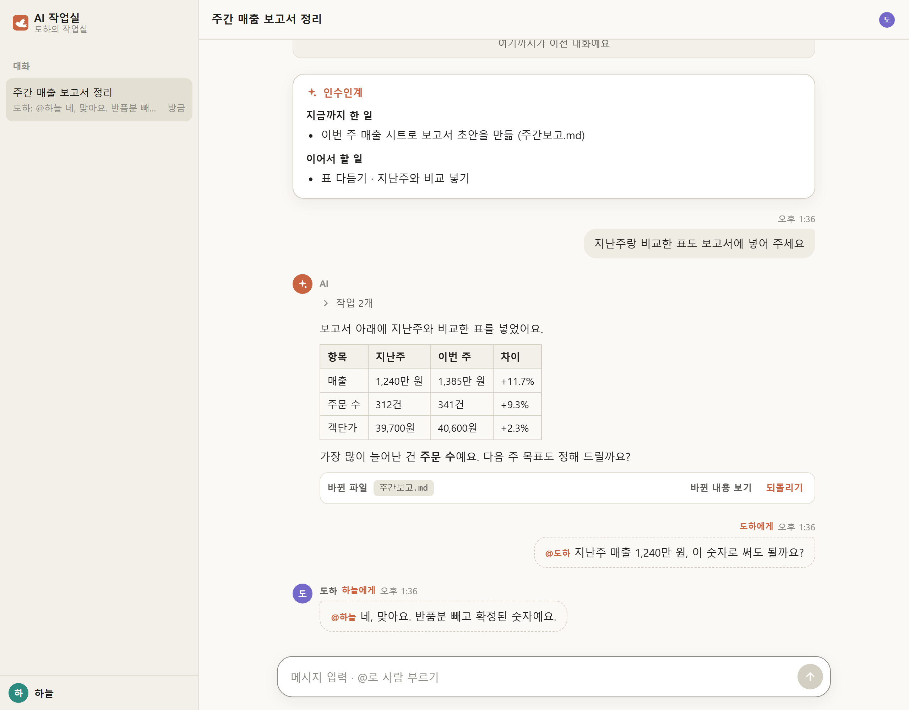
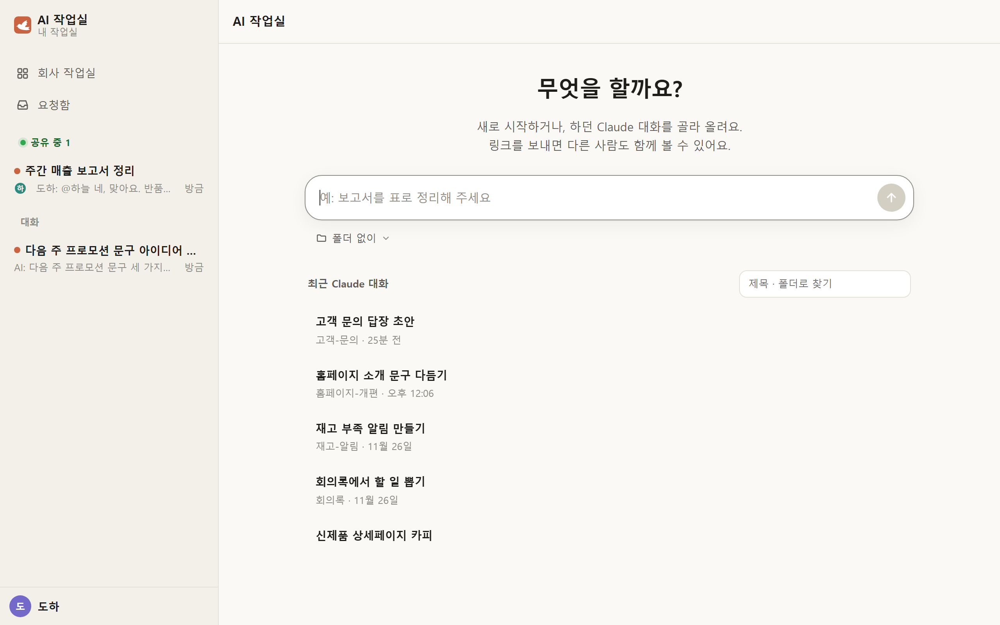
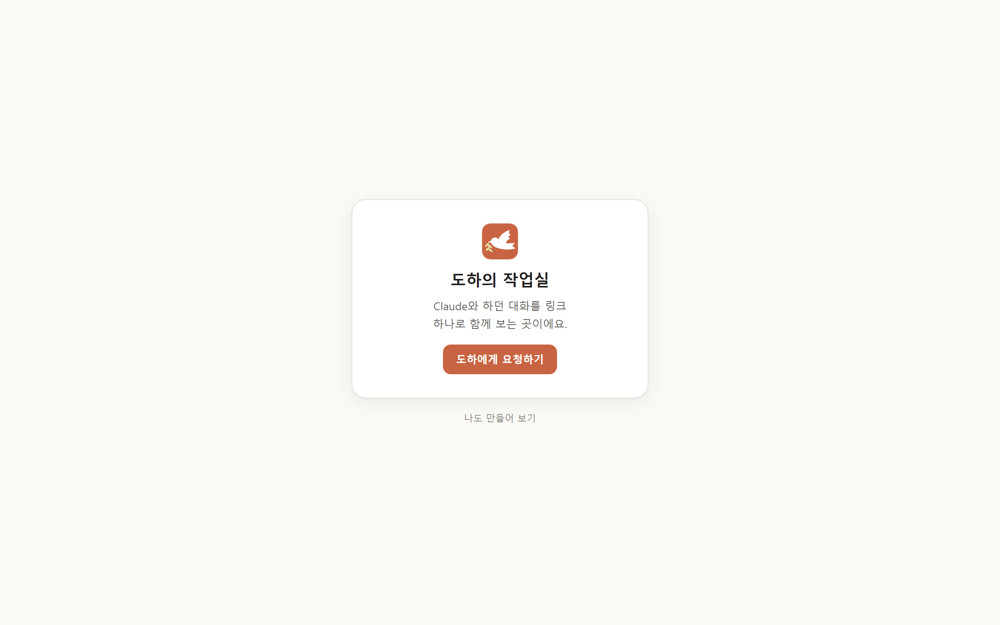

# AI 작업실

Claude Code에서 하던 대화를 **링크 하나로** 다른 사람에게 넘기고, 같은 대화 안에서 AI · 받은 사람 · 원래 담당자가 함께 일하는 작은 웹 서버입니다.

> 이 저장소는 소개용이에요. 화면은 가명과 가짜 대화로 찍었어요.



## 왜 필요한가요

AI와 하던 일을 다른 사람에게 넘기면 보통 이렇게 돼요.

- 대화를 복사해 붙이고, 어디까지 했는지 다시 설명해요.
- 받은 사람은 AI에게 처음부터 다시 설명해요.
- 숫자 하나 확인하려 해도 메신저로 원래 담당자에게 따로 물어야 해요.

AI 작업실에서는 링크 하나면 돼요. 이전 대화와 「지금까지 한 일」이 그대로 보이고, 그 자리에서 AI에게 이어서 부탁해요. 확인할 건 `@이름`으로 원래 담당자에게 바로 묻고, 원래 담당자는 PC 알림을 받아 같은 대화에서 답해요.

## 주요 기능

| 기능 | 하는 일 |
|---|---|
| 대화 넘기기 | Claude Code 창에서 `/share-claude`를 치거나, 처음 화면에서 최근 대화를 고르면 링크가 나와요 |
| 이어서 부탁하기 | 받은 사람은 설치 없이 브라우저에서 이름만 넣고 들어와 AI에게 이어서 부탁해요 |
| @로 사람 부르기 | `@이름`으로 쓴 말은 AI가 아니라 그 사람에게 가요. 사람끼리 한 말은 AI가 다음 답에서 참고해요 |
| 바뀐 파일 · 되돌리기 | AI가 고친 파일과 바뀐 내용을 보고, 한 번에 되돌릴 수 있어요 |
| 주인 확인 | 작업 폴더 밖의 파일을 만들거나 고치거나 지우는 일은 주인 화면에 확인 카드가 떠요 |
| 인수인계 | 올릴 때 「지금까지 한 일」을 정리해 보여 주고, 공유를 끄면 작업실에서 한 일이 원래 Claude 대화에 이어서 남아요 |
| 요청하기 | 링크가 없는 사람도 주인에게 할 일을 요청하고, 주인은 맞는 대화를 골라 열어 줘요 |

## 화면

| 설치한 사람의 처음 화면 | 링크 없이 온 사람 |
|---|---|
|  |  |
| 새로 시작하거나, 하던 Claude 대화를 골라 올려요 | 주인에게 할 일을 요청해요 |

## 동작 방식

```
주인 PC
  Claude Code (하던 대화) ──/share-claude──▶ 작업실 서버 (Node) ◀──── 브라우저
                                                │              (같은 망의 다른 PC · 휴대폰)
                                                ▼
                                   claude 명령으로 그 대화를 이어서 실행
```

- 작업실 서버는 주인 PC에서 도는 Node 서버예요. 외부 패키지 없이 Node 기본 기능만 써요.
- 대화를 올리면 그 Claude 대화를 `claude` 명령으로 이어서 실행하고, 응답을 화면에 실시간으로 보내요.
- AI가 도구를 쓰려 할 때마다 규칙이 바로 허락할지, 주인에게 물을지 정해요.
- AI가 일하기 전후로 작업 폴더 상태를 저장해 두어서 되돌릴 수 있어요.
- 링크에는 대화마다 다른 열쇠가 들어 있어요. 공유를 끄면 그 링크는 더 이상 열리지 않아요.
